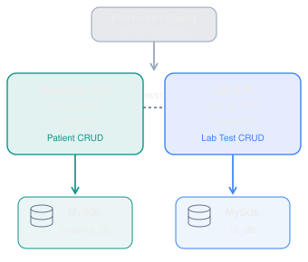

## API

A simple REST API-to-API communication project built with **Java 21**, **Spring Boot**, and **MySQL**.

## Overview

This project demonstrates how two independent Spring Boot applications communicate over HTTP using Spring `RestClient`.

## Project Structure

```text
api-communication/
├── hospital-api/    # Port 8081
└── lis-api/         # Port 8082
```

## Tech Stack

- Java 21
- Spring Boot
- Spring Web
- Spring Data JPA
- MySQL
- Maven
- RestClient

## Architecture



## Features

**Hospital API**
- Patient CRUD operations
- Soft delete (`is_active: 0`)
- REST API versioning (`/api/v1`)
- Send patient data to LIS API

**LIS API**
- Receive patient data from Hospital API
- Manage laboratory tests and results
- Soft delete support
- REST API versioning (`/api/v1`)

## API Endpoints

| Service | Base URL |
|---|---|
| Hospital API | `http://localhost:8081/api/v1` |
| LIS API | `http://localhost:8082/api/v1` |

## Communication Flow

1. Hospital API creates and stores a patient.
2. Hospital API sends patient data to LIS API via `RestClient`.
3. LIS API stores the patient in its own database.
4. LIS API manages laboratory tests and results.

## Getting Started

Run each Spring Boot application independently:

```bash
cd hospital-api
./mvnw spring-boot:run
```

```bash
cd lis-api
./mvnw spring-boot:run
```
---

**Purpose:** Learning Spring Boot REST API communication.